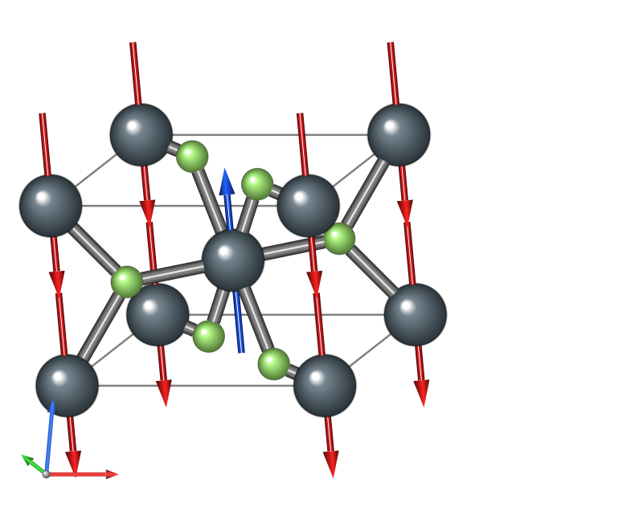
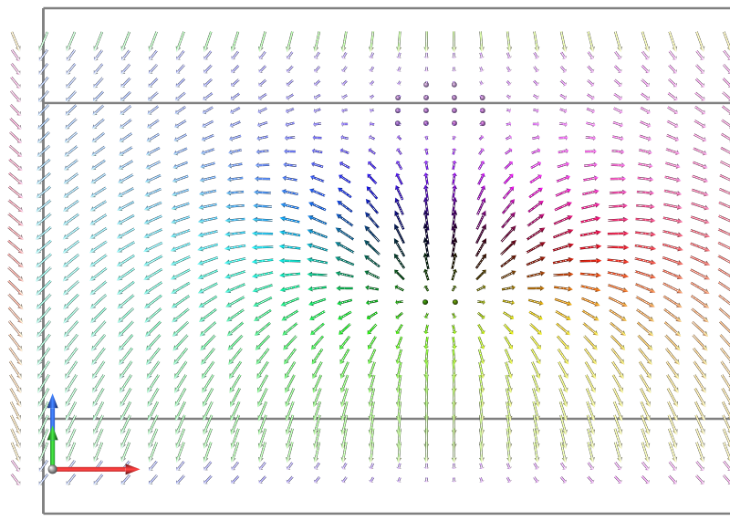
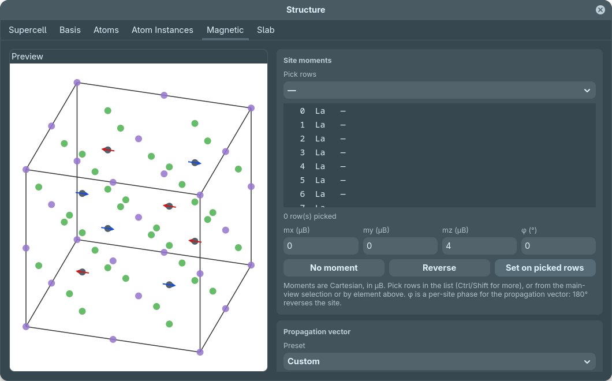

# Magnetism

CView shows magnetic moments as arrows through the atoms, builds antiferromagnetic and other ordered cells, and writes the moments back out for VASP and Quantum Espresso. It handles collinear structures (ferro-, antiferro- and ferrimagnets), canted and non-collinear ones, and spin textures such as spirals and skyrmions.

A moment is stored on each atom as a Cartesian vector in μB. Most formats carry none, so nothing changes for a structure without moments.

---

## Where the moments come from

| Source | What is read |
| :--- | :--- |
| **POSCAR / CONTCAR / `.vasp`** | The **INCAR** or **OUTCAR** in the same folder (the file names are matched without regard to case). A CONTCAR takes the OUTCAR's final moments first and the INCAR's `MAGMOM` as a fallback; a POSCAR takes the INCAR first. |
| **`vasprun.xml`** | `MAGMOM` from the run's parameters on every frame. If an OUTCAR with one `magnetization` table per ionic step sits beside it, those computed moments are used per frame instead. |
| **Quantum Espresso output** | The last "Magnetic moment per site" block of each geometry (collinear, or three values per atom for a non-collinear run). |
| **Magnetic CIF** | `.mcif`, or a `.cif` with magnetic symmetry operations. See [below](#magnetic-cif-mcif). |
| **Extended XYZ** | A `magmoms` (or `initial_magmoms`) column, one value (collinear, along z) or three per atom. The XYZ writer saves the moments the same way. |
| **OVF** | The magnetization of a mumax3, OOMMF or Spirit run. See [below](#ovf-files-mumax3-oommf-spirit). |

The System Log says where the moments came from, for example *Magnetic moments from the INCAR MAGMOM beside the file*.

### VASP details

- `MAGMOM` is used only when VASP would use it: `ISPIN = 2`, or a non-collinear run (`LNONCOLLINEAR` or `LSORBIT`). With the default `ISPIN = 1` it is ignored, so no arrows appear.
- `N*x` repeats (`2*5.0 3*0`), comments, `;` between tags and `\` line continuations are handled.
- The number of values must match the structure: N for a collinear run, 3N for a non-collinear one. Otherwise the file is skipped rather than guessed at.
- `SAXIS` is applied, so a collinear `MAGMOM` along a rotated spin axis becomes the right Cartesian vector.

### Magnetic CIF (mCIF)

The reader uses the magnetic space-group operations and centring translations of the file, each with its time-reversal flag (`x,y,z,+1`, `-x,y,z,-1`). Site moments in `_atom_site_moment.crystalaxis_x/y/z` are in μB along unit vectors parallel to **a**, **b**, **c**, as the standard defines them, and are spread over the symmetry-equivalent atoms as axial vectors:

* a rotation turns the moment;
* inversion leaves it unchanged, and a mirror keeps the component along the mirror normal and reverses the components in the mirror plane (a moment is an axial vector); and
* time reversal (`-1`) reverses it.

That is what makes a body-centred antiferromagnet such as MnF₂ come out with opposite moments on the corner and centre atoms.


 The Bilbao **MAGNDATA** database provides published structures in this format.

>[!NOTE]
>A plain `.cif` that has `_atom_site_moment` but no magnetic operations is expanded with the ordinary symmetry and no time reversal, so an antiferromagnet would come out ferromagnetic. The System Log warns when this happens. Such an order needs [the Magnetic tab](#building-a-magnetic-order) instead.

### OVF files (mumax3, OOMMF, Spirit)

`.ovf`, `.omf` and `.ohf` files hold a magnetization on a mesh of cells, usually nanometres apart. CView reads OVF 1.0 and 2.0, regular and irregular meshes, as text or binary (4 or 8 bytes), and shows one site per cell at the cell centre. Positions are converted from the file's mesh unit to Å.

* Cells where the magnetization is zero (outside the magnet in a mumax3 geometry) are left out, so a disc reads as a disc.
* A magnetization in A/m is divided by its largest magnitude, so you always see **m = M/Ms**. Structure Info shows the sum and the average of m, without a μB unit.
* Meshes above 40 000 cells are thinned (every k-th cell in x and y) to keep the CPU renderer fast; the System Log reports it.
* Only vector fields are read: a scalar field (an energy density) is refused with a message.
* Opening a mesh switches on **Arrows only** and sets the arrow length to about one cell spacing, with bonds and periodic images off.



#### Snapshot series (movies)

A mumax3 or OOMMF run writes one file per snapshot: `m000000.ovf`, `m000001.ovf`, …. Open **any one of them** and CView loads the whole series from the same folder — every file whose name is the same up to a trailing number, with the same extension — in numeric order. The main view shows the file you opened; `Structure → Trajectory Player…` plays them all (see [Trajectories](visualization.md#trajectories-relaxation-and-md)). A Spirit file holding several snapshots as segments is played the same way.

* The simulation time (`Total simulation time` in the header) is shown for each snapshot; the step is OOMMF's iteration number, otherwise the number in the file name.
* Which cells are kept, and how a magnetization in A/m is scaled, is decided from the opened snapshot and applied to all of them, so the frames are comparable.
* All snapshots are kept in memory. A long series of a large mesh is thinned further, to about 6 million cell moments in all (at least 2 000 cells per snapshot); the System Log says when it is.
* A file in the folder with a different mesh, or one that cannot be read, is left out with a warning.
* Other quantities in the same folder (`B_ext000000.ovf`) and unnumbered files (`m.ovf`) are not part of the series.

#### Topological charge and skyrmion radius

For a magnetization mesh, the Trajectory Player shows the topological charge of the current frame and plots it for every frame:

$$Q = \frac{1}{4\pi}\int \mathbf{m}\cdot\left(\partial_a \mathbf{m}\times\partial_b \mathbf{m}\right)\,da\,db$$

It is computed on the lattice after Berg and Lüscher: each plaquette of four cells is split into two triangles, and the solid angles their unit vectors span are summed. No derivatives are needed, and Q lands on an integer for a smooth texture. (a, b) are the in-plane axes taken right-handed about the film normal (the axis with the fewest cells), so a skyrmion whose core points along +z in a −z background has Q = +1, and one with the opposite polarity has Q = −1. Bloch and Néel skyrmions give the same Q. Cells outside the magnet (zero moment) are skipped. For a film several cells thick, Q is averaged over the layers.

When |Q| rounds to 1, the radius **R** is shown too: the radius of a disc with the same area as the reversed core (cells whose normal component is opposite to the background's). It follows the m_z = 0 contour to within about half a cell. For several skyrmions, no radius is given.

---

## Showing the moments

The **Magnetic Moments** group in the sidebar (under **Appearance**) controls the arrows for the active tab. The settings are per tab and are not saved between sessions.

| Control | Effect |
| :--- | :--- |
| **Show Moment Arrows** | Draw the arrows. |
| **Arrows only** | Hide the spheres of atoms that carry a moment, leaving the arrows at their full length. Use it for spin textures, where the spheres hide the pattern. Atoms without a moment (a substrate, say) stay visible. |
| **Length (Å/μB)** | Arrow length per μB. Each end of an arrow sticks out of the atom by half of |m| times this value, so small induced moments stay visible and large ones do not reach the next atom. |
| **Color by** | How the arrows are coloured (below). |
| **Up / Down** colours | The two colours used by the Up / Down mode (**Color** in Single mode). |

**Color by:**

| Mode | Use |
| :--- | :--- |
| **Auto** (default) | Up / Down when all moments are collinear, Direction otherwise. |
| **Up / Down** | Red along the structure's magnetic axis, blue against it. The axis is the line of the largest moment (oriented towards +z), so antiferromagnets and ferrimagnets split into their sublattices whichever way the spins point. |
| **Direction** | Hue from the in-plane angle, white at +z and black at −z, the usual spin-texture colouring. |
| **Single** | One colour for every arrow. |

>[!TIP]
>Near-white arrows (moments close to +z in Direction mode) are hard to see on the default light background. A grey or dark background helps.

**Structure Info** lists a moment column and the total moment: `m_z` when every moment is collinear along z, the full vector otherwise. An antiferromagnet shows a total of 0; a ferrimagnet shows its net moment.

---

## Building a magnetic order

**Structure → Magnetic Moments…** opens the **Magnetic** tab of the Structure window. It sets moments on the atoms of the current cell and, with a propagation vector, builds the larger cell an antiferromagnetic order needs. The Preview pane shows the result with its arrows.



### Site moments

A table lists every atom with its moment and phase φ.

1. **Pick rows**: select them in the list (Ctrl or Shift for several), or use the *Pick rows* menu for the **main-view selection**, **all atoms**, or **all of one element**.
2. Enter **mx, my, mz** (μB, Cartesian) and a phase, then press **Set on picked rows**. **Reverse** flips the picked moments; **No moment** clears them.

The phase is used by the propagation vector below: 180° reverses a site.

### Propagation vector

Antiferromagnets often order on a cell larger than the chemical one, which a plain CIF cannot store. Neutron-diffraction papers describe the order with a **propagation vector k** (in reciprocal-lattice units). CView builds it as

> m_j(R) = m_j · cos(2π k·R + φ_j)

for site *j* moved by the lattice vector **R**. The new cell is the old one multiplied along each axis by the denominator of the matching component of **k** (up to 12).

| Preset | k | Order (one magnetic atom per cubic cell) |
| :--- | :--- | :--- |
| Ferromagnetic | (0, 0, 0) | All parallel |
| A-type | (0, 0, ½) | Ferromagnetic planes, alternating along c |
| C-type | (½, ½, 0) | Antiferromagnetic planes, chains along c |
| G-type | (½, ½, ½) | Every neighbour antiparallel |

Components accept fractions such as `1/2` or `1/3`. A component of ⅓ gives a modulated wave (+m, −m/2, −m/2).

* With **k = 0** the cell and atom order stay as they are and only the moments are set (one undo step; selection is kept).
* With several magnetic sites per cell (rock-salt NiO, for example) use the phases: 180° on one sublattice gives the AFM-II pattern.
* The presets assume one magnetic atom per (pseudo)cubic cell, as on the B site of a perovskite.

A line under the controls gives the new cell size, atom count and net moment. **Apply** builds the structure (**Edit → Undo** reverses it), **Reload from structure** refills the table from the current structure.

>[!NOTE]
>Only single-**k** orders are built: collinear or amplitude-modulated. A helix needs two components 90° out of phase, and an incommensurate **k** has no finite cell.

### Example: G-type LaFeO₃

1. Open a cubic LaFeO₃ cell and choose **Structure → Magnetic Moments…**.
2. In *Pick rows* choose **All Fe**, enter `mz = 4`, press **Set on picked rows**.
3. Choose the **G-type** preset. The preview shows a 2×2×2 cell with alternating arrows; the net moment is 0.
4. Press **Apply**.

---

## Writing the moments for DFT

### VASP

The **DFT input** card of the Magnetic tab shows the INCAR tags for the result, with **Copy INCAR tags**:

```
ISPIN = 2
MAGMOM = 2*3.6 2*-3.6 4*0
```

* `MAGMOM` follows the order CView writes a POSCAR in: atoms are grouped by element, with the symbols in alphabetical order (Fe before O), and atoms of one element keep their order. Anything written beside a POSCAR must follow it, and these tags do.
* Moments collinear along some axis other than z are written as their component along that axis, with a comment in the output. With spin-orbit coupling, also set `SAXIS` to it.
* Non-collinear moments get `LNONCOLLINEAR = .TRUE.` and three `MAGMOM` values per atom.

When you **save a POSCAR** (File → Save As) from a structure with moments, CView also writes these tags into an `INCAR` in the same folder, but **only if there is none**. An existing INCAR is never touched; the tags go to Structure Info instead.

### Quantum Espresso

Saving as `.in` writes the magnetization into the `&SYSTEM` block. pw.x sets the starting magnetization **per species**, so CView splits each element into one species per distinct moment (`Fe1`, `Fe2`), with `nspin = 2` and a signed `starting_magnetization(i)`. Non-collinear moments get `noncolin = .true.` and `angle1`/`angle2`.

`starting_magnetization` is a fraction of the valence charge, not μB. CView scales the **largest moment to 0.5** and keeps the others in proportion; the file says so in a comment, so adjust the values for your pseudopotentials.

pw.x allows at most **10 species**. A texture with more distinct moments (a skyrmion, a spiral) is grouped: each magnetic element gets a share of the 10 slots, its moments are clustered into that many groups, and each group starts from its mean moment. The file and the System Log say when this happened.

Species labels such as `Fe1`, `Fe_up` are read back as the element, so a file written by CView opens again. The starting magnetization of a QE *input* is not read back as moments, however: it is a fraction, not μB.

---

## What editing does to the moments

| Operation | Moments |
| :--- | :--- |
| Supercell, moving atoms, deleting atoms | Kept with their atoms. |
| Changing an atom's element, or substituting an element | Dropped for those atoms: the new species' moment is not known. |
| Slab, primitive/conventional conversion, rebuilding from a space group | **Lost.** These rebuild the atoms from element and position. The System Log warns when an edit drops every moment. |

---

## Limits

* The arrows are drawn in the main view, the Structure window preview and the Trajectory Player; the 3D charge density window does not show them.
* Antiferromagnetic orders on a larger cell are only built from a single propagation vector. Searching all magnetic subgroups is not done: take a published structure from MAGNDATA as an mCIF instead.
* There is no topological charge or skyrmion builder yet; see the [To Do](../todo.md) list.
